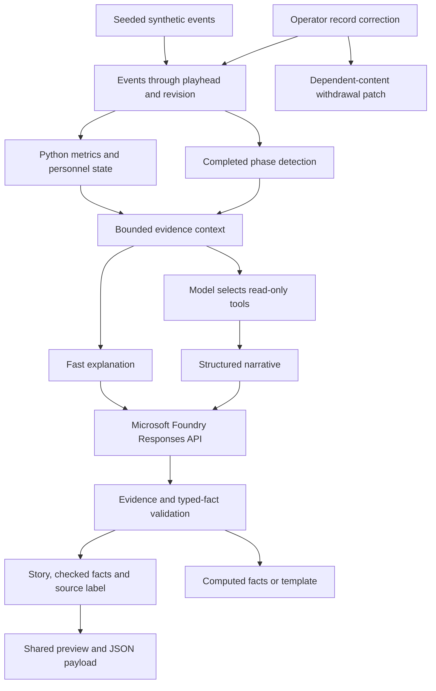

# Architecture

The FastAPI application serves the JavaScript interface and a reproducible synthetic match. Each browser has an independent playhead and revision selection.

## Code map

- `backend/engine.py`: deterministic event generation, prefix statistics, context and templates.
- `backend/match_clock.py` and `football_rules.py`: match periods and rule-state helpers.
- `backend/phases.py`: completed event-sequence detection and phase context.
- `backend/evidence_tools.py`: bounded read-only tool execution.
- `backend/narrative.py`: Foundry calls, structured output, cache, concurrency and request budgets.
- `backend/verification.py`: typed values, references and supported player-name checks.
- `backend/revisions.py` and `corrections.py`: isolated revision views and dependent-content corrections.
- `frontend/`: replay, event-location pitch, personalized explanations and Broadcast desk.

## Evidence boundaries

Evidence and statistics are limited to the selected match time. Deep tools cannot change time, revisions or match data. At full time, explanation evidence includes goals, dismissals and the final whistle, so the narrative and player-reference checks use consistent evidence.

The validation layer checks structured facts and references. Qualitative prose is not a complete semantic or causal proof. Pressure is an event tag; the UI does not infer it from video or tracking.

## Correction contract

The browser tracks displayed/exported artifact metadata. Correcting the synthetic goal entry recomputes the visible state and identifies dependent insight, recap, phase and overlay artifacts for withdrawal. The preview and export use the same payload. The original event log remains intact.

The artifact registry is browser-local, bounded to 50 entries, and not durable across production systems. Previously downloaded files require downstream handling of the exported correction patch.

## Latency and resilience

Facts render before AI finishes. Responses outside the freshness policy are discarded. One active browser request and one latest queued intent prevent a growing backlog. Identical in-flight server requests share generation; network work does not hold the global cache lock. Budget reservations are atomic. No automatic retry silently spends extra requests after a rejected response.

## Azure hosting architecture

The application integrates Microsoft Foundry inference with a single-container hosting design on Azure Container Apps. Azure Container Registry and ACR Tasks support the image lifecycle. ARM/Bicep and Azure CLI define and manage the resources, Microsoft Entra ID authenticates management, and Azure Monitor Log Analytics supplies the log destination. See [Azure deployment architecture](AZURE_DEPLOYMENT.md).
