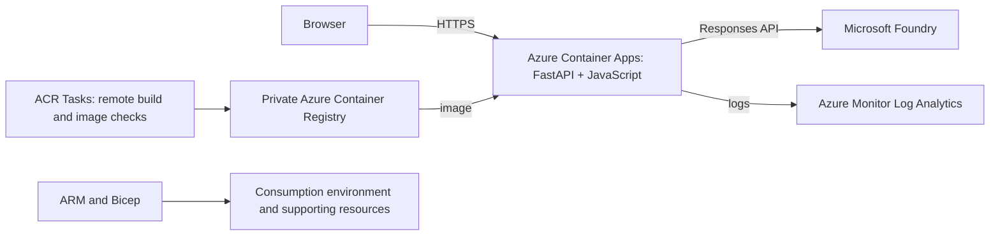

# Azure architecture and deployment

Turning XI packages FastAPI and the web frontend into one container. The infrastructure targets Azure Container Apps Consumption in `eastus2` and connects to an existing Microsoft Foundry model deployment.

## Hosted application

[Open Turning XI](https://ca-matchmind.jollystone-6e63690c.eastus2.azurecontainerapps.io). The demo uses HTTPS and allows direct access to model-generating requests without a sign-in or demo token. The hosted allowance is 800 request slots per running process. Generation stops at the limit while computed match facts remain available. Counters are not durable across platform restarts or scale-to-zero; manual releases can carry forward the observed count. This is not a cumulative hosting-wide billing hard stop.

## Service configuration

- One container serves the frontend and API on port 8000.
- Container Apps Consumption: 0.5 vCPU, 1 GiB memory, minimum 0 and maximum 1 replica.
- HTTPS ingress with startup, readiness and liveness probes.
- A private Basic ACR stores versioned Linux images.
- ACR Tasks builds and checks images remotely.
- Container Apps secret references provide the model key and registry credential. An optional `protectModelAccess` parameter can enable a demo-token gate; it is disabled for the public judging demo.
- A Log Analytics workspace is provisioned for optional operational logging. The cost-minimized demo configuration disables persistent log ingestion; live diagnostics can use Container Apps log streaming.
- Azure CLI management uses Microsoft Entra ID authentication.

Resource names retain the original MatchMind naming convention. The public product is Turning XI.

## Release workflow

1. Prepare a minimal build context containing application source, Dockerfile and locked dependencies.
2. Check the context for credentials and exclude local CLI state, approval records and private environment files.
3. Compile and validate Bicep, review ARM what-if output and confirm resource scope and costs.
4. Build the current image through ACR Tasks and record its tag/digest.
5. Check container startup, deploy to Container Apps and verify HTTPS/health probes.
6. Verify the configured access mode, real inference within the approved allowance, replay and correction behavior, and logging.
7. Record the endpoint and decide retention/cleanup according to the approved hosting period.

## Source layout

`infra/main.bicep`, `registry.bicep` and `platform.bicep` describe the staged deployment. `bootstrap.parameters.json` contains non-secret defaults. Model keys, access tokens, CLI credentials and private parameter files belong outside version control.

## Operational boundaries

The bounded single-model workflow uses server-side credentials. The broadcast artifact registry is browser-local. Model request counters, replica limits and log caps are application/operational controls, not an Azure billing hard stop. Existing Foundry resources are separate from the dedicated application-hosting resource group.
